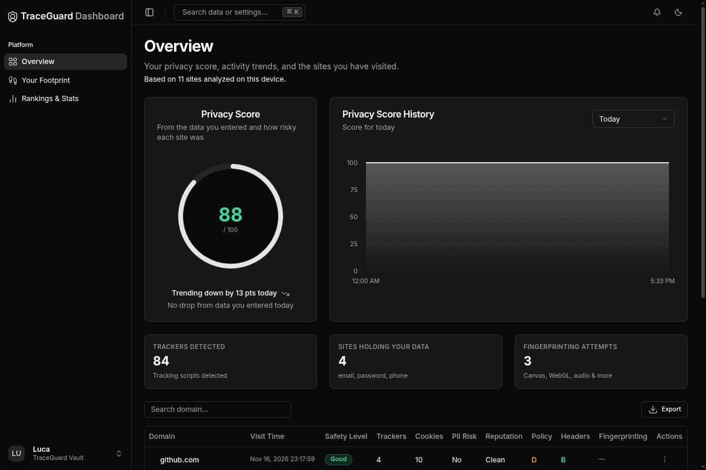
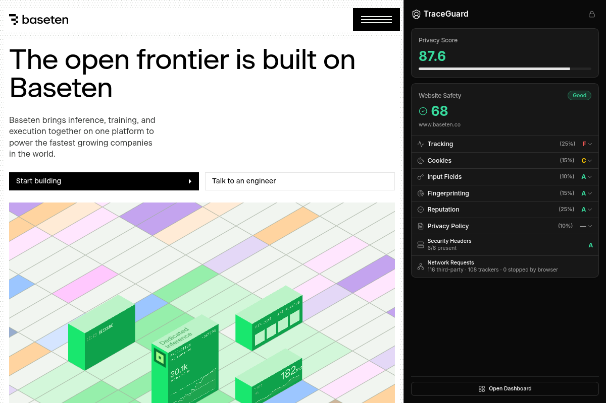

# TraceGuard Privacy Extension


[](LICENSE)
[](https://github.com/luca-liceti/TraceGuard-Privacy-Extension/actions/workflows/ci.yml)
[](https://chromewebstore.google.com/detail/traceguard-privacy-extens/memioiifpdmcllgojjglncadobmhdhlo)

TraceGuard is a powerful, real-time privacy scoring and auditing Chrome Extension. It empowers users with transparent insights into how websites interact with their data, helping them make informed decisions about their digital footprint.

## Why TraceGuard is Useful

Unlike traditional blockers that operate silently, TraceGuard provides transparent, quantified privacy analysis through two innovative metrics:
- **Website Safety Score (WSS)**: A 0-100 safety rating for every site visited based on reputation, tracking, cookies, input fields, and policy strength.
- **User Privacy Score (UPS)**: A status score derived from the personal data you have entered and how risky each site was. It falls when you hand data to a risky site, and recovers slowly as older entries age.

### Key Features
- **Real-Time Tracker Detection**: Identifies third-party trackers using a curated list plus bundled databases (DuckDuckGo Tracker Radar, EasyPrivacy, Disconnect).
- **PII Monitoring**: Detects sensitive form inputs and warns you when you start typing into one on a low-trust site. The warning shows what the ledger already knows: whether this site already holds that field type, how many other sites do, and what else the site holds. The detector fires on the first character entered into a field, never on the value itself.
- **Cookie Auditing**: Detects tracking cookies from `Set-Cookie` headers and the DOM, cookie names and metadata only, never values (no `cookies` permission required).
- **Policy Grading**: Bundled ToS;DR ratings, optional live lookups, and off-by-default local policy reports for unrated sites when no saved report exists and a capable Ollama model is loaded.
- **Footprint Ledger**: A dashboard page showing what you have handed over, by field type and site, plus which tracker companies covered how much of your browsing. Built entirely from data already stored locally.
- **Weekly Privacy Digest**: An in-app toast, at most once a week, summarizing recent personal-info entries, low-scoring sites, and tracker companies from data already on the device. Turn it off in Settings, **Notifications**.
- **Modern Dashboard**: An interactive, responsive control center built with React, Vite, Tailwind CSS, and shadcn/ui.
- **Local-First**: Core analysis runs on-device, with no accounts or telemetry. Optional AI uses your local Ollama server; optional policy reports fetch policy pages from the sites being checked. Sensitive data is encrypted behind a master password (the "vault").

## What TraceGuard does not do

- **It does not block anything.** TraceGuard observes and scores. It has no blocking permission, and a request recorded as blocked was blocked by your browser or by another extension.
- **It never sees what you type.** It records the type of field you interacted with, never the value, and it records on the first keystroke, so an abandoned form looks the same as a submitted one.
- **It has no account, backend, or telemetry.** Optional ToS;DR lookups reveal the requested site domain to ToS;DR. When Local Policy Reports is enabled, TraceGuard requests policy pages directly from those sites; the static fetch omits cookies, but a rendered-tab fallback may use your browser session and send applicable cookies. Policy text and selected summary facts go only to Ollama on your device.
- **It cannot see what a site did with your data afterwards**, or whether you reuse passwords.

## Screenshots





## Threat Feed & Signed Updates

The malware/phishing blocklist is built locally from public, no-account feeds ([OpenPhish](https://openphish.com/feed.txt) and [phishunt](https://phishunt.io)), and matching is done on-device. Separately, Local Policy Reports, when enabled, request policy pages from the sites being checked; Live Rating Lookup can send a site's domain to ToS;DR. See [PRIVACY.md](PRIVACY.md) for all network requests.

To keep that blocklist fresh between extension releases, the background worker periodically fetches a **signed** update (`phishlist.signed.json`) and only accepts it when its Ed25519 signature verifies against an embedded public key, it is fresher than the last accepted feed, and it is newer than what is already stored. Any failure falls back to the bundled snapshot.

### Key management

```bash
npm run generate:threat-keys   # creates scripts/keys/threat-signing-key.pem (gitignored, KEEP SECRET)
npm run build:phishlist        # rebuild src/assets/phishlist.json from the feeds
npm run sign:phishlist         # sign it -> src/assets/phishlist.signed.json (commit this)
```

The private key must **never** be committed. Store it as a GitHub Actions secret named `THREAT_SIGNING_KEY` so the release workflow can sign fresh feeds. Rotating the key invalidates all previously signed feeds, regenerate, re-sign, and redeploy the public key (`THREAT_FEED_PUBLIC_KEY_HEX` in `src/background/services/threat-feed.ts`) together.

## Getting Started

### Prerequisites
- [Node.js](https://nodejs.org/) (v20.19+ or v22.12+)
- [npm](https://www.npmjs.com/) (v9 or higher)
- Google Chrome 114 or newer (or a Chromium-based browser with the side-panel API)

### Installation & Setup

1. **Clone the repository**
   ```bash
   git clone https://github.com/luca-liceti/TraceGuard-Privacy-Extension.git
   cd TraceGuard-Privacy-Extension/traceguard-extension
   ```

2. **Install dependencies**
   ```bash
   npm install
   ```

3. **Build the extension**
   ```bash
   npm run build
   ```
   *(For active development with hot-reloading, run `npm run dev`)*

4. **Load into Chrome**
   - Open Chrome and navigate to `chrome://extensions/`
   - Enable **Developer mode** in the top right corner
   - Click **Load unpacked**
   - Select the `dist` folder located inside the `traceguard-extension` directory

### Usage Example
Once installed, TraceGuard runs automatically in the background. You can open the side panel by clicking the extension icon or use the Command Palette (`Cmd+K` / `Ctrl+K`) in the dashboard to navigate between Overview, Rankings and Stats, Footprint, and Settings.

## Getting Help

If you encounter issues or have questions, please use the following resources:
- **Discussions**: [GitHub Discussions](https://github.com/luca-liceti/TraceGuard-Privacy-Extension/discussions) for questions, ideas, and community support.
- **Issue Tracker**: [GitHub Issues](https://github.com/luca-liceti/TraceGuard-Privacy-Extension/issues) to report bugs or request features.
- **Privacy Policy**: Read our privacy commitments in [PRIVACY.md](PRIVACY.md).

## Documentation

- **[ARCHITECTURE.md](ARCHITECTURE.md)**: how the extension is put together, its runtime contexts, storage model, the vault, and the scoring rules.
- **[adr/](adr/README.md)**: the decisions that shape the project, each with its reasoning.
- **[ROADMAP.md](ROADMAP.md)**: what is being built next, and what would make us stop.
- **[CHANGELOG.md](CHANGELOG.md)**: release history.
- **[PRIVACY.md](PRIVACY.md)**: what is stored, what is not, and why.
- **[CREDITS.md](CREDITS.md)**: the data, models and ideas borrowed from other projects, including ToS;DR and Docbot, and the terms they come under.
- **[CONTRIBUTING.md](CONTRIBUTING.md)** and **[VERSIONING.md](VERSIONING.md)**: contributing and releases.
The `docs/` folder is deliberately not versioned. It holds local working material: the audit reports, store-listing drafts, branding, and screenshots, none of which belong in the repository.

## Maintainers and Contributing

**TraceGuard** is actively maintained by [@luca-liceti](https://github.com/luca-liceti) and the open-source privacy community.

We welcome contributions of all kinds, from bug fixes to new detectors! To get started:
1. Please read our contribution guidelines in [CONTRIBUTING.md](CONTRIBUTING.md).
2. Run `npm run typecheck` and `npm run test:run` (or `npm run build`) to verify your changes before submitting a pull request.

*Together, we can create a safer, more transparent web.*
